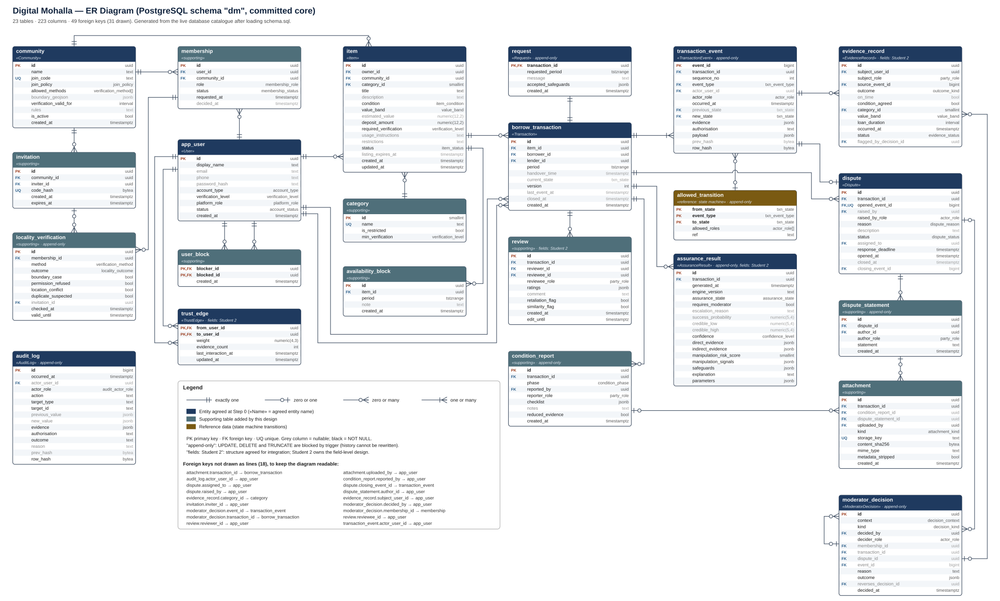

# Digital Mohalla: ER Diagram and Schema Design (Append-Only Event Store)

| | |
|---|---|
| **Deliverable** | Design Phase 2, Student 1: ER Diagram / Schema Design (with append-only event store) |
| **Depends on** | `state_machine/State_Machine_Design.md` v1.1 (states, events, transitions) and the Step-0 entity list |
| **Version** | 1.0, 10 October 2026 |
| **Target DBMS** | PostgreSQL 14 or later (overview section 4 already names PostgreSQL). Tested on PostgreSQL 16.2. |

**Files in `er_schema/`**

| File | What it is |
|---|---|
| `er_diagram.svg` / `er_diagram.png` | The ER diagram (crow's foot), for the report |
| `schema.sql` | The physical schema: tables, constraints, triggers, functions, views, reference data, privileges |
| `test_schema.py` | 41 automated checks that run `schema.sql` on a real PostgreSQL and try to break every rule |
| `test_results.txt` | Output of the last run: **41/41 passed** |
| `generate_erd.py` | Builds the ER diagram **from the live database catalogue**, so the diagram cannot disagree with the SQL |



*Figure 1. ER diagram of the committed core. 23 tables, 223 columns, 49 foreign keys. 31 are drawn as lines; the other 18 (mostly "who did it" columns pointing at `app_user`) are listed in the legend box.*

---

## 1. Summary

The schema turns the state machine into a database that **cannot be put into an illegal state**, even if the application code has a bug.

- **Event sourcing.** `transaction_event` is the source of truth. The `borrow_transaction` row is a *projection*: a cached copy of the current state that only a trigger may update.
- **The state machine lives in the database.** Table `allowed_transition` holds all 74 leaf-level transitions from State_Machine_Design.md section 6. Every new event is checked against it, then against the actor's role and identity, then against the guards that can be checked from data.
- **History cannot be rewritten.**
  - Nine tables are append-only: triggers reject UPDATE, DELETE and TRUNCATE, even for a superuser.
  - The application's database role has no UPDATE or DELETE privilege on them.
  - Events and the audit log are **hash-chained**, so an edit made by switching triggers off is still detected.
- **Location privacy.** No column anywhere stores coordinates or an address. A raw GPS fix is used in memory and only the coarse outcome is saved. Photos are rejected unless their metadata (EXIF GPS) has been stripped. An automated test scans the whole schema for location-like columns.
- **No double booking.** A per-item lock plus an overlap check covers both accepted bookings and dates the lender has blocked.

All 41 tests pass on PostgreSQL 16.2 (`test_results.txt`). The tests cover the happy path, every class of invalid transition, a real two-connection race, tampering, privileges, double booking, locality, disputes and privacy.

---

## 2. Entities: the 12 agreed at Step 0 plus 11 supporting tables

### 2.1 Agreed entities → tables

| Step-0 entity | Table | Note |
|---|---|---|
| User | `app_user` | `user` is a reserved word in PostgreSQL |
| Community | `community` | |
| Request | `request` | 1:1 with Transaction (DD-1). Holds what the borrower asked for; immutable. |
| Item | `item` | |
| Transaction | `borrow_transaction` | `transaction` is an SQL keyword. This is the aggregate root and projection. |
| TransactionEvent | `transaction_event` | Append-only event store |
| EvidenceRecord | `evidence_record` | Verified outcome facts used by the assurance engine (§5.12) |
| AssuranceResult | `assurance_result` | One row per assessment; reassessment adds a row |
| Dispute | `dispute` | Created automatically by the `DISPUTE_OPENED` event |
| ModeratorDecision | `moderator_decision` | Membership, pre-acceptance review and dispute decisions, including reversals |
| AuditLog | `audit_log` | Non-lifecycle actions and rejected commands. The view `v_audit_trail` merges it with events. |
| TrustEdge | `trust_edge` | Directed, weighted edge for k-hop trust (§5.5) |

### 2.2 Supporting tables (each needed by a specific requirement)

| Table | Why it is needed | Source |
|---|---|---|
| `membership` | User–Community is many-to-many and has its own status and role (member or moderator) | UC-A3, A4; locality eligibility (T02/T03) |
| `locality_verification` | Stores the **coarse result** of each check, never the raw location; periodic re-verification | §1 locality; UC-A3 3a–3c |
| `invitation` | Invitation is a verification method; only a hash of the code is stored; single use | UC-A3 3d |
| `user_block` | G1 guard and auto-decline when users block each other | UC-A7; B5 7a |
| `category` | Restricted categories and minimum verification level | §3; UC-I2 2b |
| `availability_block` | Dates the lender blocks; checked against bookings | UC-B2 |
| `allowed_transition` | The state machine as reference data | State_Machine_Design.md §6 |
| `condition_report` | Handover and return checklists ("both parties confirm condition") | UC-B7, B8; §3 step 9 |
| `attachment` | Photo and document metadata; files are stored outside the database | UC-B7, B12 |
| `dispute_statement` | Each party's claim and response | UC-B12 step 8; I4 |
| `review` | Ratings feed manipulation signals (collusion, retaliation) | UC-D1; scenarios 4 and 5 |

**Deliberately not modelled** (supporting or stretch scope): listings for rent, sell or swap, chat messages (G1), notifications storage, events, vendors, forum and chatbot. They can be added later without changing anything here.

---

## 3. How to read the diagram

- **Crow's foot ends:**
  - `||` exactly one
  - `o|` zero or one
  - `o<` zero or many
  - `|<` one or many
  - The end nearest a box is the maximum; the outer symbol is the minimum.
- **Row markers:** PK primary key, FK foreign key, UQ unique.
  - Black column = NOT NULL; grey column = nullable.
- **Header colours:**
  - Dark blue = Step-0 entity, with its agreed name in «guillemets».
  - Teal = supporting table.
  - Brown = reference data.
  - "append-only" and "fields: Student 2" tags appear under the table name.
- **Cardinalities come from the database itself.**
  - A NOT NULL foreign key gives `||` on the parent side; a nullable one gives `o|`.
  - A unique foreign key gives a 1:1 relationship.
  - Two cardinalities are enforced by a deferred trigger rather than a key, so they are set by hand:
    - every Transaction has exactly one Request;
    - every Transaction has at least one event.

**Key relationships, in words:**

| Relationship | Meaning |
|---|---|
| Community 1 — 0..* Membership 0..* — 1 User | A user can belong to many communities, each with its own approval status and role |
| Membership 1 — 0..* LocalityVerification | Each (re)verification adds a coarse result; the latest one counts |
| Item 1 — 0..* Transaction | An item is borrowed many times. Overlap is prevented by trigger, not by a key. |
| User 1 — 0..* Transaction (as borrower) and (as lender) | Two separate roles; borrower ≠ lender is a CHECK |
| Transaction 1 — 1 Request | DD-1, accepted at Step 0 |
| Transaction 1 — 1..* TransactionEvent | The event history; `(transaction_id, sequence_no)` is unique |
| AllowedTransition 0..1 — 0..* TransactionEvent | Every event except the first must match a rule (composite foreign key) |
| TransactionEvent 1 — 0..1 Dispute (opened by) | A dispute always points to the event that opened it |
| Transaction 1 — 0..* AssuranceResult | Every (re)assessment is kept, which supports the "transparent evidence updating" demo |
| TransactionEvent 1 — 0..* EvidenceRecord | Evidence can only come from a verified closing event |
| ModeratorDecision 0..1 — 0..* ModeratorDecision (reverses) | Reversals keep both decisions (scenario 11) |

---

## 4. The append-only event store

### 4.1 Event record

| Column | Agreed field | Rule |
|---|---|---|
| `actor_user_id`, `actor_role` | actor | `SYSTEM` if and only if no user id. The trigger checks that the user really is that party, moderator or admin. |
| `occurred_at` | timestamp | **Set by the server** (`clock_timestamp()`), so a client cannot back-date an event |
| `previous_state` | previous state | Must equal the current projected state. NULL only for event 1. |
| `new_state` | new state | Must form an allowed transition with `previous_state` and `event_type` |
| `evidence` (jsonb) | evidence | References: `condition_report_id`, `assurance_result_id`, attachment ids |
| `authorisation` | authorisation | `party:borrower`, `party:lender`, `role:moderator@<community>`, `role:admin` or `system:<job>`. A CHECK ties it to `actor_role`. |
| `transaction_id`, `sequence_no`, `event_type`, `payload` | the 4 fields added at Step 0 | `UNIQUE (transaction_id, sequence_no)` |
| `prev_hash`, `row_hash` | (tamper evidence) | `row_hash = SHA-256(prev_hash ‖ row content)` |

### 4.2 What happens when an event is inserted

```
INSERT INTO transaction_event (...)
  │
  ├─ BEFORE trigger event_validate()
  │    a. lock the transaction row (FOR UPDATE)              → serialises writers of one transaction
  │    b. sequence_no = version + 1, previous_state = current → else 40001 "stale command"
  │    c. (previous_state, event_type, new_state) in allowed_transition, actor_role allowed
  │    d. actor really is the borrower / lender / active moderator of the item's community (not a party) / active admin
  │    e. event-specific guards (locality result recomputed, assurance link, condition reports,
  │       deposit, extension date, dispute reason, both parties heard, only raiser withdraws, reason recorded)
  │    f. shallow-history check when leaving a dispute (must resume the phase it came from)
  │    g. compute prev_hash and row_hash
  ├─ CHECK constraints and the composite FK to allowed_transition
  ├─ AFTER trigger event_apply()
  │    update projection (state, version, period, closed_at); create or update the dispute row
  │      └─ BEFORE UPDATE trigger on borrow_transaction: no double booking (lock item, check overlaps)
  └─ commit-time constraint trigger: every transaction has its REQUEST_CREATED event and request row
```

Everything runs in one database transaction, so either all of it happens or none of it does. A rejected command leaves **no event** behind, exactly as State_Machine_Design.md §7.3 requires.

### 4.3 Why each mechanism exists

| Mechanism | Requirement it implements | Proven by test |
|---|---|---|
| `allowed_transition` + composite FK + trigger | Invalid transitions X1–X15 (SM §7) | X1, X4, X6, X13 |
| Version check under row lock | Optimistic concurrency (SM §8); B6 *a; B13 7a | "Stale command", "Race" (real two-connection test) |
| Actor checks | Authorisation field; X10 (party cannot moderate) | "Wrong role", "Impersonation", "moderator party" |
| Locality result recomputed in the database | DD-3: the transaction cannot be told it is ELIGIBLE when the stored evidence says otherwise | "Locality" |
| `requires_moderator` ↔ target state | DD-4: the single integration field with Student 2 decides T04/T05 | "Assurance link" |
| Condition reports and deposit required | X2, X3; UC-B7 6a; "both parties confirm condition" | "Handover" |
| History check | DD-11 shallow history | "Dispute withdraw", "RESUME" |
| Append-only triggers and revoked privileges | X14; I6 "logs are not altered" | "Append-only ×3", "App role" |
| Hash chain + `verify_event_chain()` | Tamper evidence for moderator-misuse checks (§5.13) | "Tamper evidence" |
| `replay_state()` | Event-sourcing replay (§13 testing) | "Happy path: replay = projection" |
| Server-side timestamps | Events cannot be back-dated | (by construction) |

### 4.4 What the database does *not* enforce, and why

- **Time-based transitions** (`after(...)`, `when(now > ...)`) are fired by process 6.0 (the scheduler). The database accepts them from `SYSTEM` only, but cannot know that 48 hours really passed: wall-clock rules belong to the scheduler. Every such event is still recorded with its server timestamp, so it can be audited afterwards.
- **Student 2's decision policy** (what makes `requires_moderator` true) is the engine's job. The database only guarantees that the transaction follows the flag.
- **Notification delivery and file storage** are outside the database.

---

## 5. Location privacy (Student 1 responsibility)

This is the part of the design that answers the defence panel's location question.

1. **No location columns.** `app_user` has no address. `item` is located only by its `community`. No table has latitude, longitude or GPS columns. Test "Privacy scan" searches every column name in the schema.
2. **Coarse results only.**
   - `locality_verification` stores `method`, `outcome` (VERIFIED, INCONCLUSIVE, CONFLICTING, INSUFFICIENT) and flags.
   - There is **no negative outcome**: GPS evidence never rejects a person automatically (UC-A3 3a–3c). A CHECK forces a permission refusal to be recorded as INSUFFICIENT, never as negative.
3. **The request-time check reads stored results only.** `locality_eligibility()` uses membership status and the latest coarse result. ELIGIBLE, INCONCLUSIVE and INELIGIBLE follow the DD-3 rules, and the event trigger recomputes the result so it cannot be faked.
4. **Photos.** `attachment.metadata_stripped` must be true (CHECK). An image still carrying EXIF GPS data cannot be registered.
5. **The community boundary** (`community.boundary_geojson`) is the society's coarse polygon. It is community data, not personal data, and it is needed for geofencing.
6. **Exact meeting point.** It is shared only after acceptance (state AWAITING_HANDOVER), through the chat module, which is outside this schema. Retention of those messages is an open question (section 10).

---

## 6. Normalisation and deliberate exceptions

- **Third normal form.** Facts are stored once: the community of an item, the role of a member, the parties of a transaction. Many-to-many relationships use their own tables (`membership`, `user_block`, `trust_edge`).
- **Deliberate denormalisations, each with a reason:**

| Where | What is copied | Why |
|---|---|---|
| `borrow_transaction.current_state`, `version`, `closed_at` | Derived from the events | A *projection* for fast queries. Rebuilt and checked by `replay_state()`. Only the trigger writes it. |
| `request.requested_period` vs `borrow_transaction.period` | Initially equal | The request is what was *asked*; the period changes with extensions |
| `evidence_record.category_id`, `value_band`, `loan_duration` | Copied from the item and transaction | A historical snapshot: similarity must use the values at the time of the loan, even if the item later changes |
| `dispute` status and closing columns | Derived from events | Projection for the moderator queue; maintained by the trigger |

- **jsonb columns** (`evidence`, `payload`, `checklist`, `ratings`, `safeguards`, `direct_evidence`):
  - Used only where the content is variable per event type or still being designed by Student 2.
  - Everything the database needs to *enforce* is a typed column.
  - Each jsonb column has a type CHECK (object or array).

---

## 7. Indexes and performance

- `transaction_event (transaction_id, sequence_no)` is unique, so replaying one transaction is a single index range scan.
- Bookings are looked up by `borrow_transaction (item_id)`. `availability_block` has a GiST index on `period`.
- Partial unique indexes enforce "one live membership per user and community" and "one live dispute per transaction".
- Expected volume (the overview estimates 50–100 users and 200–300 transactions in the pilot) is tiny for PostgreSQL. The indexes exist for correctness and clarity more than for speed.

---

## 8. Testing

```bash
pip install pgserver psycopg2-binary
```

```bash
python test_schema.py
```

`pgserver` starts an embedded PostgreSQL, so no installation is needed. To use your own server instead, set `DM_TEST_DSN`. **The script drops and recreates the schema `dm` in the target database.**

The 41 tests (listed with references in `test_results.txt`) cover:

- the structure;
- the happy path, including replay and the hash chain;
- the invalid transitions X1, X4, X6 and X13;
- wrong-role and impersonation attempts;
- stale commands and a real concurrent race;
- append-only behaviour (UPDATE, DELETE and TRUNCATE);
- tamper detection;
- application-role privileges;
- double booking, blocked dates and extensions;
- the dispute lifecycle with shallow history, RESUME, escalation and admin-only decisions;
- locality eligibility;
- the Student 2 interface;
- the handover deposit and condition reports;
- G1, the deferred start check and suspended users;
- review and evidence eligibility;
- attachment metadata;
- duplicate memberships and permission refusal;
- the privacy scan;
- the audit chain and decision reasons.

One honest note: the first full run gave 40/41. The failure was a mistake in a *test*, which confirmed a handover as the wrong user. The database correctly refused it. After fixing the test, all 41 pass.

---

## 9. Design decisions and alternatives (for the viva)

**DS-1. Enforce the state machine in the database, not only in the application.**
- *Alternative:* validate only in application code. Rejected because any bug, script or manual SQL could write an illegal history, and in an event-sourced system history is the truth.
- Defence in depth: the application validates first (for good error messages); the database guarantees it.

**DS-2. One table for all event types, with a jsonb payload.**
- *Alternative:* one table per event type. Rejected because replay needs one ordered stream per transaction, and 31 tables would make that impossible to read in order.

**DS-3. Projection updated by trigger in the same database transaction.**
- *Alternative:* update the projection asynchronously. Rejected for the pilot: it would let readers see stale states. Synchronous updates keep the "check, then append" logic simple and correct.

**DS-4. Per-item lock instead of an exclusion constraint.**
- PostgreSQL can prevent overlapping ranges with `EXCLUDE USING gist (item_id WITH =, period WITH &&)`, but that needs the `btree_gist` extension.
- It also cannot check a *second* table, the lender's blocked dates.
- The trigger handles both. It is proven by the race and double-booking tests and is portable to any PostgreSQL install.
- Note: it relies on the default READ COMMITTED isolation level.

**DS-5. Hash chain per transaction (events) and one global chain (audit log).**
- A per-transaction chain does not need a global lock on the busiest table.
- The audit log is low-volume, so a single chain with an advisory lock is fine.

**DS-6. UUID keys for business objects, bigint for logs.**
- UUIDs can be generated by the app and are not guessable in URLs.
- Logs need cheap, ordered ids.

**DS-7. The dispute row is created by the event, not by the application.**
- A transaction can never be DISPUTED without a dispute record, or the other way round.

**DS-8. Attachments may be deleted (retention) but never edited.**
- Privacy may require deleting a photo later.
- The event history keeps only references and SHA-256 hashes, so it stays valid after the file is gone.

---

## 10. Inputs still needed (none block the design)

| # | Question | Who | Current placeholder |
|---|---|---|---|
| Q1 | Retention periods for photos, address-evidence documents and meeting-point chat messages | Team / supervisor | Not enforced yet; deletion is allowed for `attachment` |
| Q2 | Verification validity period for periodic re-checks | Team | `community.verification_valid_for` = 365 days |
| Q3 | Final field list for `assurance_result`, `evidence_record`, `trust_edge`, `review` | **Student 2** | Fields from overview §5.2–5.12. Tagged "fields: Student 2" on the diagram. |
| Q4 | Thresholds that map an item value to `value_band` | Student 2 | Enum LOW / MEDIUM / HIGH / VERY_HIGH |
| Q5 | Is the chat (G1) in the committed core? Its messages are dispute evidence. | Team | Not modelled |

---

## 11. Hand-offs

- **Student 2 (Data Dictionary and Domain Model).**
  - Every table, column, type and constraint is in `schema.sql`. Field descriptions for the data dictionary can be generated from the catalogue.
  - The assurance tables are a starting structure for you to refine.
- **Student 3 (sequence diagrams).**
  - Lifelines can use the processes from the DFD (3.0 records commands, 4.0 assesses).
  - Messages are the event types.
  - A rejected command returns 40001, 42501, 23514 or 23P01, as in section 4.
- **Student 1, next steps.**
  - The **Component Diagram** (Phase 3).
  - The **pseudocode for replay and transition validation.** `replay_state()` and `event_validate()` in `schema.sql` are the reference implementation to describe.

---

## 12. Viva preparation

- **"Why is there both a transaction table and an event table?"** The events are the truth. The transaction row is a cached answer to "what state is it in now?". `replay_state()` rebuilds the answer from the events, and a test proves the two agree.
- **"How do you stop someone editing history?"** Four layers:
  1. Triggers reject UPDATE, DELETE and TRUNCATE.
  2. The application's role lacks those privileges.
  3. Each event carries a hash of the previous one.
  4. Even a superuser who switches the triggers off is caught by `verify_event_chain()`.
- **"Where are invalid transitions handled?"** In `allowed_transition` plus `event_validate()`. Anything not in the table fails, with SQLSTATE 23514.
- **"What if two people act at once?"** The transaction row is locked and the sequence number must be the next one. The second writer gets 40001 and must re-read the state. This is shown with two real connections in the test.
- **"Where is the location stored?"** Nowhere, by design. Only coarse outcomes are stored. A test scans the schema to prove it.
