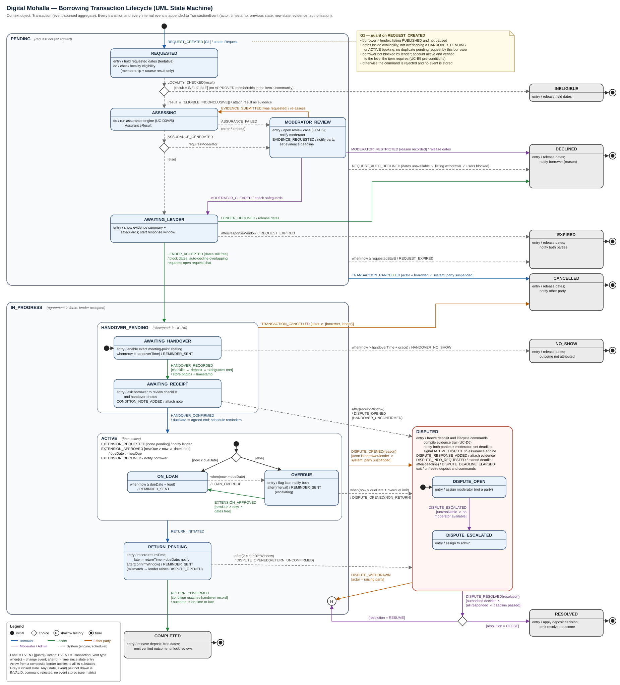

# Digital Mohalla: Transaction State Machine Design

| | |
|---|---|
| **Deliverable** | Design Phase, Phase 1, Student 1: State Machine Diagram (including invalid transitions) |
| **Owner** | Student 1 (transaction and location infrastructure) |
| **Version** | 1.1, 10 October 2026. Step-0 meeting accepted all proposals (DD-1, RESUME, removed "Returned", tentative hold, extra event fields). See change log at the end. |
| **Scope** | Committed core only: the borrowing transaction from request to closure (overview section 3, post-defence lifecycle) |
| **Files** | `transaction_state_machine.svg` (vector, use in report), `transaction_state_machine.png` (2x raster), this document |

*Figure 1. UML state machine for the `Transaction` aggregate. Colours show who triggers each transition; dashed grey arrows are system-triggered (assurance engine or scheduler).*

---

## 1. Summary

The diagram models **one object: a borrowing `Transaction`**, from the moment a borrower sends a request until it is closed. It has:

- **5 composite states:** `PENDING`, `IN_PROGRESS`, `HANDOVER_PENDING`, `ACTIVE` and `DISPUTED`.
- **11 working (non-terminal) leaf states.**
- **7 closed states:** `COMPLETED`, `RESOLVED`, `DECLINED`, `CANCELLED`, `EXPIRED`, `NO_SHOW` and `INELIGIBLE`.
- **31 event types.** These are the exact values stored in `TransactionEvent.event_type`.
- **33 external transitions and 12 internal transitions**, all listed in section 6.
- **A validity matrix** (section 7) showing every command that is *invalid* in every state. Section 7 also says what the system does when an invalid command arrives.

Every row of every table traces back to overview section 3, section 5 or a numbered use case. Section 11 lists the places where the use cases contradict each other or the overview, and the resolution this design adopts. **The team needs to confirm those resolutions in the Step-0 meeting.**

---

## 2. Why a state machine, and why for this object

- The rubric (Data / Process / Behaviour Design, 10 marks) asks for diagrams that are *project-specific and thoroughly explained*. The handbook lists "Network Automata / Graphs or State Machine" under Behaviour Design.
- The transaction is the object whose **behaviour depends on its history**. The same command ("confirm return", "open dispute") is legal in one state and illegal in another. A state machine is the standard way to specify exactly that.
- The overview says the lifecycle is **event-sourced**: *"every transition is stored as an event and the current state is derived from the event history."* This makes the state machine the **specification of the event store**:
  - Each arrow is an event type that can be appended.
  - Each guard is a validation rule.
  - Each missing arrow is a command that must be rejected.
- The panel's criticism was "limited technical challenges". Section 13 (Testing) explicitly lists *invalid transitions, concurrent requests and replay of the event log* as computing work. This diagram is the base for all three.

---

## 3. Inputs analysed and scoping decisions

| Source | What was taken from it |
|---|---|
| Overview §3, *Post-Defence Borrowing Lifecycle (Event-Sourced)* | The 13 lifecycle steps (the backbone) and the event record fields |
| Overview §3, old *Borrowing Lifecycle* | Additional states (Rejected, Cancelled, Expired, Disputed, No-show). Old names are mapped in section 4.3 |
| Overview §1, *Locality Verification and Location Privacy* | What the locality check may read (coarse result only), and the rule against automatic rejection on GPS evidence |
| Overview §5.6, 5.8, 5.9, 5.11, 5.12 | Escalation triggers; "restrict only after a human decision"; the four assurance states; evidence entering only after confirmations |
| Overview, *Post-Defence Evaluation Scenarios* (12) | Each scenario is traced to a path through the machine (section 10.3) |
| Use cases B5, B6, B7, B8, B12, B13 | Borrowing commands, extensions, timers and dispute pre-conditions |
| Use cases D3/4/5, D6, I1, I4, A3, A7, B2 | Assurance step, escalation, admin and moderator powers, blocking, calendar effects |
| Work division (Step 0 list) | Entity names, the four assurance states, the event record fields |

**Out of scope, deliberately:**

- **Listing lifecycle** (`Draft → Published → Paused → Expired`). This belongs to `Item`, not to `Transaction`. Section 3 says the post-defence lifecycle *"starts at the request rather than at listing publication"*. The transaction only needs the guard "listing is PUBLISHED" (G1).
- **Event lifecycle, vendor orders and the "wanted item" post (B9).** These are supporting or stretch scope.
- **Reviews (D1), appeals and decision reversals (I4 4a/4b).** These happen *after* closure. They are recorded against `ModeratorDecision`, `EvidenceRecord` and `AuditLog`, and do not move the transaction (decision DD-17).

---

## 4. States

### 4.1 Composite states

| Composite | Meaning | Why it exists |
|---|---|---|
| `PENDING` | Request exists but nothing is agreed yet | Three exits apply to *every* pending substate: cancel, auto-decline and start-date expiry. Drawing them once on the border avoids 12 duplicate arrows. |
| `IN_PROGRESS` | The lender has accepted; obligations are in force | A dispute can be opened from any substate (B12). This composite owns the **history pseudostate H** used to return after a dispute. |
| `HANDOVER_PENDING` | Accepted, item not yet handed over (= "Accepted / Handover pending" in B6) | Groups the two-party handover. Either party can cancel from anywhere inside it. |
| `ACTIVE` | Item is with the borrower | Extension handling applies in both substates, so it is drawn once as internal transitions of `ACTIVE`. |
| `DISPUTED` | A case is open for moderator or admin decision | Its entry action freezes the deposit and all other lifecycle commands. |

### 4.2 Leaf states (state dictionary)

| # | State | In composite | Meaning (what we are waiting for) | Who acts next | Possible exits |
|---|---|---|---|---|---|
| S1 | `REQUESTED` | PENDING | Request stored and dates tentatively held; locality eligibility being checked | System | ASSESSING, INELIGIBLE, (border exits) |
| S2 | `ASSESSING` | PENDING | Assurance engine computing the evidence summary | System (Student 2's engine) | AWAITING_LENDER, MODERATOR_REVIEW, (border) |
| S3 | `MODERATOR_REVIEW` | PENDING | Engine asked for human review, or the engine failed. The request is held and not yet shown to the lender. | Moderator (or the party asked for evidence) | AWAITING_LENDER, ASSESSING, DECLINED, (border) |
| S4 | `AWAITING_LENDER` | PENDING | Lender sees the evidence summary and safeguards and must accept or decline | Lender | HANDOVER_PENDING, DECLINED, EXPIRED, (border) |
| S5 | `AWAITING_HANDOVER` | HANDOVER_PENDING | Parties must meet. Exact meeting point now shareable. | Lender (records handover) | AWAITING_RECEIPT, NO_SHOW, CANCELLED, DISPUTED |
| S6 | `AWAITING_RECEIPT` | HANDOVER_PENDING | Lender recorded checklist and photos; borrower must confirm receipt | Borrower | ACTIVE, CANCELLED, DISPUTED |
| S7 | `ON_LOAN` | ACTIVE | Item with borrower, not yet due | Borrower | OVERDUE, RETURN_PENDING, DISPUTED |
| S8 | `OVERDUE` | ACTIVE | Due date passed, item not returned | Borrower | ON_LOAN (extension), RETURN_PENDING, DISPUTED |
| S9 | `RETURN_PENDING` | IN_PROGRESS | Borrower says the item is returned (with condition statement); lender must confirm condition | Lender | COMPLETED, DISPUTED |
| S10 | `DISPUTE_OPEN` | DISPUTED | Case with the community moderator | Moderator / parties | DISPUTE_ESCALATED, RESOLVED, H |
| S11 | `DISPUTE_ESCALATED` | DISPUTED | Moderator could not resolve, or no moderator is available | Admin / parties | RESOLVED, H |

| Closed state | Reached when | Entry action | Evidence produced for the assurance engine |
|---|---|---|---|
| `COMPLETED` | Lender confirms the returned condition matches the handover record | Release deposit, free dates, emit verified outcome, unlock reviews | **Yes.** Success, on time or late, condition agreed (§5.12) |
| `RESOLVED` | Moderator or admin closes a dispute | Apply deposit decision, emit resolved outcome | **Yes.** The outcome decided by the moderator (§5.12, "Conflicting reports") |
| `DECLINED` | Lender declines, moderator restricts, or system auto-declines | Release dates, notify borrower with reason | No |
| `CANCELLED` | Borrower withdraws (pending); either party cancels before handover; system cancels on suspension | Release dates, notify other party | No (Student 2 may later count cancellations as a weak signal) |
| `EXPIRED` | Lender silent past the response window, or start date passed while pending | Release dates, notify both | No |
| `NO_SHOW` | Nobody recorded a handover by handover time + grace | Release dates; **outcome not attributed** to either party | No. The system cannot know who failed to show, so it does not accuse (§5.13 principle). |
| `INELIGIBLE` | Borrower has no APPROVED membership in the item's community | Release held dates | No |

Each closed state has a completion arrow to a UML final state. The record itself stays in the event store permanently.

### 4.3 Mapping from names used elsewhere

The use cases still use the pre-defence vocabulary. Use this table to update them, or to explain the difference in the report:

| Name in use cases / old lifecycle | Name in this design | Why |
|---|---|---|
| Draft, Published | *(not transaction states)* | Belong to `Item` |
| Request received (B5, B10) | `AWAITING_LENDER` | §3 adds locality and evidence steps before the lender sees the request (`REQUESTED`, `ASSESSING`) |
| Accepted / Handover pending (B6, B7, B13) | `HANDOVER_PENDING` (`AWAITING_HANDOVER` → `AWAITING_RECEIPT`) | B6 already treats them as one state |
| Active | `ACTIVE` (`ON_LOAN` / `OVERDUE`) | "Late" in B13 becomes the explicit `OVERDUE` substate |
| Return requested (B8, B12) | `RETURN_PENDING` (entered by event `RETURN_INITIATED`) | §3 wording is "Return initiated". The state is named for what it waits on, to avoid a state and an event with the same name. |
| Returned | *(removed)* | Transient in B8. See DD-8. |
| Completed | `COMPLETED` | |
| Rejected (B6) | `DECLINED` | §3 says "accepts or declines" |
| Cancelled, Expired, No-show, Disputed | `CANCELLED`, `EXPIRED`, `NO_SHOW`, `DISPUTED` | Unchanged |

---

## 5. Events: what gets stored

### 5.1 Event record (one row in `TransactionEvent` per transition or internal event)

| Field | Agreed at Step 0? | Content |
|---|---|---|
| `actor` | Yes | user id, plus role in this transaction: BORROWER, LENDER, MODERATOR, ADMIN or SYSTEM |
| `timestamp` | Yes | server time (UTC) |
| `previous_state` | Yes | leaf state before the event |
| `new_state` | Yes | leaf state after the event. **Equal to `previous_state` for internal events** (reminders, extensions, notes, responses). |
| `evidence` | Yes | references: photo ids, checklist id, `AssuranceResult` id, locality result, message ids |
| `authorisation` | Yes | the basis on which the actor was allowed: `party:borrower`, `party:lender`, `role:moderator@community-12`, `role:admin`, `system:scheduler-job-7` or `system:assurance-engine` |
| `transaction_id`, `sequence_no`, `event_type`, `payload` | **Proposed addition** | Needed for event sourcing. `sequence_no` gives order and concurrency control (section 8). `event_type` is one of the 31 below. `payload` holds data such as new due date, reason or resolution. |

### 5.2 Event catalogue (31 event types)

| Event type | Actor | Kind | Notes and payload |
|---|---|---|---|
| `REQUEST_CREATED` | Borrower | External | item, dates, message, accepted safeguards; creates `Request` |
| `LOCALITY_CHECKED` | System | External | result = ELIGIBLE, INCONCLUSIVE or INELIGIBLE (coarse result only) |
| `ASSURANCE_GENERATED` | System | External | `AssuranceResult` id, assurance state, `requiresModerator` |
| `ASSURANCE_FAILED` | System | External | error or timeout (D3 *a) |
| `EVIDENCE_REQUESTED` | Moderator | Internal | what is needed, deadline |
| `EVIDENCE_SUBMITTED` | Borrower / Lender | External | evidence refs; triggers reassessment |
| `MODERATOR_CLEARED` | Moderator | External | safeguards to attach, reason; creates `ModeratorDecision` |
| `MODERATOR_RESTRICTED` | Moderator | External | reason (mandatory); creates `ModeratorDecision` |
| `LENDER_ACCEPTED` | Lender | External | handover time |
| `LENDER_DECLINED` | Lender | External | optional reason, optional suggested dates (DD-14) |
| `REQUEST_AUTO_DECLINED` | System | External | reason: dates unavailable, listing withdrawn or users blocked |
| `REQUEST_EXPIRED` | System | External | reason: response window or start date passed |
| `TRANSACTION_CANCELLED` | Borrower / Lender / System | External | reason |
| `REMINDER_SENT` | System | Internal | type: handover, due-soon, overdue (escalation level), return-confirmation |
| `HANDOVER_RECORDED` | Lender | External | checklist, photos, deposit received (flag `reducedEvidence` if no photos, B7 3a) |
| `CONDITION_NOTE_ADDED` | Borrower | Internal | comment or photos disputing recorded condition (B7 5a) |
| `HANDOVER_CONFIRMED` | Borrower | External | due date fixed |
| `HANDOVER_NO_SHOW` | System | External | none |
| `LOAN_OVERDUE` | System | External | none |
| `EXTENSION_REQUESTED` | Borrower | Internal | proposed new due date |
| `EXTENSION_APPROVED` | Lender | Internal / External | new due date (external when it moves OVERDUE → ON_LOAN) |
| `EXTENSION_DECLINED` | Lender | Internal | none |
| `RETURN_INITIATED` | Borrower | External | borrower's condition statement and optional photos (first half of "both parties confirm condition") |
| `RETURN_CONFIRMED` | Lender | External | lender's return checklist and photos (second half); outcome on-time or late |
| `DISPUTE_OPENED` | Borrower / Lender / System | External | reason: CONDITION_MISMATCH, DAMAGE, NON_RETURN, NO_SHOW, HANDOVER_UNCONFIRMED, RETURN_UNCONFIRMED, PARTY_SUSPENDED or OTHER; creates `Dispute` |
| `DISPUTE_RESPONSE_ADDED` | Borrower / Lender | Internal | statement and evidence |
| `DISPUTE_INFO_REQUESTED` | Moderator / Admin | Internal | new deadline |
| `DISPUTE_DEADLINE_ELAPSED` | System | Internal | which party did not respond (I4 2a) |
| `DISPUTE_ESCALATED` | Moderator / System | External | reason: unresolvable, or no moderator available (D6 2b) |
| `DISPUTE_RESOLVED` | Moderator / Admin | External | resolution = CLOSE or RESUME, outcome, deposit disposition, reason; creates `ModeratorDecision` |
| `DISPUTE_WITHDRAWN` | Raising party | External | reason (parties settled, B12 8b) |

---

## 6. Complete transition table

Notation: **Event [guard] / action**. "Border" means the transition leaves from the composite border and applies to every substate.

### 6.1 External transitions

| ID | From | Event [guard] / action | To | Actor | Source |
|---|---|---|---|---|---|
| T01 | initial | `REQUEST_CREATED` [G1] / create Request; hold dates tentatively | REQUESTED | Borrower | §3 step 1; B5 |
| T02 | REQUESTED | `LOCALITY_CHECKED` [result = INELIGIBLE] / release dates | INELIGIBLE | System | §3 step 2; §1 |
| T03 | REQUESTED | `LOCALITY_CHECKED` [result ∈ {ELIGIBLE, INCONCLUSIVE}] / attach result as evidence | ASSESSING | System | §3 step 2; scenarios 9 and 10 |
| T04 | ASSESSING | `ASSURANCE_GENERATED` [¬ requiresModerator] / store AssuranceResult | AWAITING_LENDER | System | §3 step 3; D3/4/5 |
| T05 | ASSESSING | `ASSURANCE_GENERATED` [requiresModerator] / open review case | MODERATOR_REVIEW | System | D3 4a; §5.9; §5.11 mapping |
| T06 | ASSESSING | `ASSURANCE_FAILED` / log failure | MODERATOR_REVIEW | System | D3 *a; B5 5c |
| T07 | MODERATOR_REVIEW | `EVIDENCE_SUBMITTED` [evidence was requested] / re-assess | ASSESSING | Party | §3 "verified events update…"; mid-eval demo "transparent evidence updating" |
| T08 | MODERATOR_REVIEW | `MODERATOR_CLEARED` [moderator ∉ parties] / attach safeguards | AWAITING_LENDER | Moderator | §5.9; A4 pattern |
| T09 | MODERATOR_REVIEW | `MODERATOR_RESTRICTED` [moderator ∉ parties ∧ reason given] / release dates | DECLINED | Moderator | §5.6 "restrict only after a human decision" |
| T10 | AWAITING_LENDER | `LENDER_ACCEPTED` [actor = lender ∧ dates still free] / block dates; auto-decline overlapping requests; open request chat | HANDOVER_PENDING → AWAITING_HANDOVER (default entry) | Lender | §3 step 4; B6 5–9 |
| T11 | AWAITING_LENDER | `LENDER_DECLINED` / release dates; notify | DECLINED | Lender | §3 step 4; B6 5a |
| T12 | AWAITING_LENDER | after(responseWindow) / `REQUEST_EXPIRED` | EXPIRED | System | B6 *b; B13 step 4 |
| T13 | PENDING (border) | `REQUEST_AUTO_DECLINED` [dates unavailable ∨ listing withdrawn ∨ users blocked] | DECLINED | System | B6 8; B2 4b; A7 |
| T14 | PENDING (border) | when(now ≥ requestedStart) / `REQUEST_EXPIRED` | EXPIRED | System | New. A request cannot stay pending after its start date. |
| T15 | PENDING (border) | `TRANSACTION_CANCELLED` [actor = borrower ∨ system on party suspension] | CANCELLED | Borrower / System | B6 *a; I1 3a |
| T16 | AWAITING_HANDOVER | `HANDOVER_RECORDED` [actor = lender ∧ checklist complete ∧ required deposit recorded ∧ safeguards met] / store photos + timestamp | AWAITING_RECEIPT | Lender | B7 1–4, 6a |
| T17 | AWAITING_RECEIPT | `HANDOVER_CONFIRMED` [actor = borrower] / dueDate := agreed end; schedule reminders | ACTIVE → ON_LOAN (default entry) | Borrower | §3 steps 5–6; B7 5–8 |
| T18 | AWAITING_HANDOVER | when(now > handoverTime + grace) / `HANDOVER_NO_SHOW` | NO_SHOW | System | B7 *a; B13 step 5 |
| T19 | AWAITING_RECEIPT | after(receiptWindow) / `DISPUTE_OPENED`(HANDOVER_UNCONFIRMED) | DISPUTED | System | New. §5.9 "evidence contradictory or insufficient". |
| T20 | HANDOVER_PENDING (border) | `TRANSACTION_CANCELLED` [actor ∈ {borrower, lender}] / release dates | CANCELLED | Party | Old lifecycle "Cancelled"; nothing has changed hands |
| T21 | ACTIVE initial → choice | default entry: [now ≤ dueDate] → ON_LOAN; [else] → OVERDUE | ON_LOAN / OVERDUE | none | Needed for return via history (DD-11) |
| T22 | ON_LOAN | when(now > dueDate) / `LOAN_OVERDUE` | OVERDUE | System | B8 6a; B13 step 7 |
| T23 | OVERDUE | `EXTENSION_APPROVED` [actor = lender ∧ newDue > now ∧ dates free] / dueDate := newDue | ON_LOAN | Lender | B8 1a |
| T24 | OVERDUE | when(now > dueDate + overdueLimit) / `DISPUTE_OPENED`(NON_RETURN) | DISPUTED | System | B8 *a; B13 step 7; scenario 8 |
| T25 | ACTIVE (border) | `RETURN_INITIATED` [actor = borrower] / record returnTime and condition statement | RETURN_PENDING | Borrower | §3 step 8; B8 1–2 |
| T26 | RETURN_PENDING | `RETURN_CONFIRMED` [actor = lender ∧ condition matches handover record] / outcome := on-time or late | COMPLETED | Lender | §3 steps 9, 12, 13; B8 3–7 |
| T27 | RETURN_PENDING | after(2 × confirmWindow) / `DISPUTE_OPENED`(RETURN_UNCONFIRMED) | DISPUTED | System | B8 5b |
| T28 | IN_PROGRESS (border) | `DISPUTE_OPENED`(reason) [actor is borrower or lender ∨ system on party suspension] | DISPUTED → DISPUTE_OPEN | Party / System | §3 step 10; B12; B7 5a; B8 5a; I1 3a |
| T29 | DISPUTED initial | default entry | DISPUTE_OPEN | none | |
| T30 | DISPUTE_OPEN | `DISPUTE_ESCALATED` [unresolvable ∨ no moderator available] | DISPUTE_ESCALATED | Moderator / System | I4 3a; D6 2b |
| T31 | DISPUTED (border) → choice | `DISPUTE_RESOLVED` [authorised decider ∧ (all responded ∨ deadline passed)] [resolution = CLOSE] / apply deposit decision; emit outcome | RESOLVED | Moderator / Admin | §3 steps 11–13; I4 |
| T32 | DISPUTED (border) → choice | `DISPUTE_RESOLVED` [same guard] [resolution = RESUME] / apply corrected terms | IN_PROGRESS (H) | Moderator / Admin | New, see DD-11 (accepted at Step 0). |
| T33 | DISPUTED (border) | `DISPUTE_WITHDRAWN` [actor = party who raised it] | IN_PROGRESS (H) | Party | B12 8b |

**Authorised decider:**

- In `DISPUTE_OPEN`: the item community's moderator, or an Admin as alternate (A4). The moderator must not be the borrower or the lender.
- In `DISPUTE_ESCALATED`: Admin only.

**G1** (on `REQUEST_CREATED`, from B5 pre-conditions and extensions). All of the following must hold:

- borrower ≠ lender;
- listing is PUBLISHED and not paused;
- dates are inside availability and do not overlap a `HANDOVER_PENDING` or `ACTIVE` booking;
- the borrower has no duplicate pending request for the same item and dates;
- the borrower is not blocked by the lender;
- the borrower's account is active and verified to the level the item requires.

If G1 fails, the command is rejected and **no transaction exists** (no event is stored).

### 6.2 Internal transitions (state does not change, event still stored with previous = new)

| ID | In state | Event [guard] / action | Actor | Source |
|---|---|---|---|---|
| I01 | MODERATOR_REVIEW | `EVIDENCE_REQUESTED` / notify party, set evidence deadline | Moderator | D6 1a |
| I02 | AWAITING_HANDOVER | when(now ≥ handoverTime) / `REMINDER_SENT` | System | B7 *a; §3 step 7 |
| I03 | AWAITING_RECEIPT | `CONDITION_NOTE_ADDED` / attach note | Borrower | B7 5a |
| I04 | ACTIVE | `EXTENSION_REQUESTED` [no extension pending] / notify lender | Borrower | §3 step 7; B8 1a |
| I05 | ACTIVE | `EXTENSION_APPROVED` [newDue > now ∧ dates free] / dueDate := newDue | Lender | B8 1a |
| I06 | ACTIVE | `EXTENSION_DECLINED` / notify borrower | Lender | B8 1a |
| I07 | ON_LOAN | when(now ≥ dueDate − lead) / `REMINDER_SENT` | System | B13 step 6 |
| I08 | OVERDUE | after(interval) / `REMINDER_SENT` (escalating) | System | B8 *a; B13 step 7 |
| I09 | RETURN_PENDING | after(confirmWindow) / `REMINDER_SENT` | System | B8 5b |
| I10 | DISPUTED | `DISPUTE_RESPONSE_ADDED` / attach evidence | Party | B12 8 |
| I11 | DISPUTED | `DISPUTE_INFO_REQUESTED` / extend deadline | Moderator / Admin | I4 3 |
| I12 | DISPUTED | after(deadline) / `DISPUTE_DEADLINE_ELAPSED` (record non-response) | System | B12 8a; I4 2a |

**UML priority rule (used on purpose):** `EXTENSION_APPROVED` is both an internal transition of `ACTIVE` (I05) and an external transition from `OVERDUE` (T23). In UML the innermost state's transition wins. So in `ON_LOAN` the event just moves the due date; in `OVERDUE` it also moves the loan back to `ON_LOAN`.

---

## 7. Invalid transitions

In a UML state machine, **anything not drawn is not allowed**. The work division asks for invalid transitions explicitly, so this section makes them visible and says how the system reacts.

### 7.1 Validity matrix: user commands × states

Key:

- `→ X` = valid, moves to X.
- `●` = valid internal event (no state change).
- `✗` = **invalid**.
- `(g)` = valid only if the guard holds.

State columns:

| Code | State | Code | State | Code | State |
|---|---|---|---|---|---|
| REQ | REQUESTED | AWH | AWAITING_HANDOVER | RTP | RETURN_PENDING |
| ASM | ASSESSING | AWR | AWAITING_RECEIPT | DOP | DISPUTE_OPEN |
| MRV | MODERATOR_REVIEW | ONL | ON_LOAN | DES | DISPUTE_ESCALATED |
| AWL | AWAITING_LENDER | OVD | OVERDUE | CLS | any closed state |

| Command (actor) | REQ | ASM | MRV | AWL | AWH | AWR | ONL | OVD | RTP | DOP | DES | CLS |
|---|---|---|---|---|---|---|---|---|---|---|---|---|
| Cancel (borrower) | →CANCELLED | →CANCELLED | →CANCELLED | →CANCELLED | →CANCELLED | →CANCELLED | ✗ | ✗ | ✗ | ✗ | ✗ | ✗ |
| Cancel (lender) | ✗ | ✗ | ✗ | ✗ (decline instead) | →CANCELLED | →CANCELLED | ✗ | ✗ | ✗ | ✗ | ✗ | ✗ |
| Accept (lender) | ✗ | ✗ | ✗ | →AWH (g) | ✗ | ✗ | ✗ | ✗ | ✗ | ✗ | ✗ | ✗ |
| Decline (lender) | ✗ | ✗ | ✗ | →DECLINED | ✗ | ✗ | ✗ | ✗ | ✗ | ✗ | ✗ | ✗ |
| Clear request (moderator) | ✗ | ✗ | →AWL (g) | ✗ | ✗ | ✗ | ✗ | ✗ | ✗ | ✗ | ✗ | ✗ |
| Restrict request (moderator) | ✗ | ✗ | →DECLINED (g) | ✗ | ✗ | ✗ | ✗ | ✗ | ✗ | ✗ | ✗ | ✗ |
| Request evidence (moderator) | ✗ | ✗ | ● | ✗ | ✗ | ✗ | ✗ | ✗ | ✗ | ✗ | ✗ | ✗ |
| Submit evidence (party) | ✗ | ✗ | →ASM (g) | ✗ | ✗ | ✗ | ✗ | ✗ | ✗ | ✗ | ✗ | ✗ |
| Record handover (lender) | ✗ | ✗ | ✗ | ✗ | →AWR (g) | ✗ | ✗ | ✗ | ✗ | ✗ | ✗ | ✗ |
| Add condition note (borrower) | ✗ | ✗ | ✗ | ✗ | ✗ | ● | ✗ | ✗ | ✗ | ✗ | ✗ | ✗ |
| Confirm receipt (borrower) | ✗ | ✗ | ✗ | ✗ | ✗ | →ONL | ✗ | ✗ | ✗ | ✗ | ✗ | ✗ |
| Request extension (borrower) | ✗ | ✗ | ✗ | ✗ | ✗ | ✗ | ● (g) | ● (g) | ✗ | ✗ | ✗ | ✗ |
| Approve extension (lender) | ✗ | ✗ | ✗ | ✗ | ✗ | ✗ | ● (g) | →ONL (g) | ✗ | ✗ | ✗ | ✗ |
| Decline extension (lender) | ✗ | ✗ | ✗ | ✗ | ✗ | ✗ | ● (g) | ● (g) | ✗ | ✗ | ✗ | ✗ |
| Initiate return (borrower) | ✗ | ✗ | ✗ | ✗ | ✗ | ✗ | →RTP | →RTP | ✗ | ✗ | ✗ | ✗ |
| Confirm return (lender) | ✗ | ✗ | ✗ | ✗ | ✗ | ✗ | ✗ | ✗ | →COMPLETED (g) | ✗ | ✗ | ✗ |
| Open dispute (party) | ✗ | ✗ | ✗ | ✗ | →DOP | →DOP | →DOP | →DOP | →DOP | ✗ | ✗ | ✗ |
| Add dispute response (party) | ✗ | ✗ | ✗ | ✗ | ✗ | ✗ | ✗ | ✗ | ✗ | ● | ● | ✗ |
| Request dispute info (moderator/admin) | ✗ | ✗ | ✗ | ✗ | ✗ | ✗ | ✗ | ✗ | ✗ | ● | ● | ✗ |
| Escalate dispute (moderator) | ✗ | ✗ | ✗ | ✗ | ✗ | ✗ | ✗ | ✗ | ✗ | →DES | ✗ | ✗ |
| Resolve dispute | ✗ | ✗ | ✗ | ✗ | ✗ | ✗ | ✗ | ✗ | ✗ | →RESOLVED / H (moderator or admin, g) | →RESOLVED / H (admin, g) | ✗ |
| Withdraw dispute (raising party) | ✗ | ✗ | ✗ | ✗ | ✗ | ✗ | ✗ | ✗ | ✗ | →H (g) | →H (g) | ✗ |

System events are not commands from users. They fire only in the states shown on the diagram:

- `LOCALITY_CHECKED`: REQUESTED only.
- `ASSURANCE_*`: ASSESSING only.
- `REQUEST_AUTO_DECLINED`, start-date expiry: any PENDING state.
- `HANDOVER_NO_SHOW`: AWAITING_HANDOVER.
- `LOAN_OVERDUE`: ON_LOAN.
- System `DISPUTE_OPENED`: AWAITING_RECEIPT, OVERDUE, RETURN_PENDING, or any IN_PROGRESS state on party suspension.

When a timer fires and the state has already changed, the scheduler's command fails the version check (section 8) and is discarded. **This is exactly B13 7a.**

### 7.2 Notable invalid transitions and why they must be blocked

| # | Attempted transition | Why it is invalid | Requirement it protects |
|---|---|---|---|
| X1 | ACTIVE → COMPLETED (lender closes without a return step) | No return confirmation means no verified outcome | §5.12: an outcome enters the evidence only when handover and return confirmations exist |
| X2 | AWAITING_HANDOVER → ACTIVE (skip borrower's receipt) | Handover is a two-party fact; one side alone is not evidence | §3 step 5; B7 |
| X3 | Borrower confirms receipt in AWAITING_HANDOVER | There is no recorded checklist or photos to agree to | B7 step 4 before step 5 |
| X4 | Lender accepts in REQUESTED, ASSESSING or MODERATOR_REVIEW | Would bypass the locality check, the evidence summary or the moderator | §3 order (steps 1–4); §5.9 |
| X5 | Borrower and lender are the same user | Self-dealing manufactures reputation | §5.13 "trivial exchanges used to manufacture reputation"; G1 |
| X6 | Cancel in ON_LOAN or OVERDUE | The item is physically with the borrower; "cancel" would erase an obligation. The borrower must return it, or a party opens a dispute. | A7 2a, I1 3a ("not silently cancelled") |
| X7 | Open a dispute in a PENDING state | Nothing has changed hands. Decline, cancel or report (D7) instead. | B12 pre-conditions |
| X8 | Open a second dispute while DISPUTED | One case per transaction | B12 2a; D6 2a |
| X9 | Confirm return, extension or cancel while DISPUTED | Transitions are frozen until resolution | B12 step 6 and post-conditions |
| X10 | Moderator who is the borrower or lender decides the case | Conflict of interest | §5.13 "moderator misuse"; A4 4b |
| X11 | Resolve before the other party responded and before the deadline | The other party must be heard first | B12 8, 8a; I4 2a |
| X12 | Withdraw a system-opened dispute (e.g. NON_RETURN) | Only the party who raised a dispute may withdraw it; system disputes need a decision | B12 8b |
| X13 | Any command on COMPLETED, RESOLVED, DECLINED, CANCELLED, EXPIRED, NO_SHOW or INELIGIBLE | Closed. Later facts (reviews, appeals, reversals) are separate records. | I4 4a; event-sourcing append-only |
| X14 | Editing or deleting an existing event | Corrections are new events; history is never rewritten | §3 event sourcing; I6 "logs are not altered" |
| X15 | Accept after the dates were taken by another acceptance, or approve an extension into another booking | Double booking | B5 4a; B6 6a; B8 1a |

### 7.3 What the system does with an invalid command

Validation runs in this order:

1. **Authorisation.** Is this actor allowed to issue this event in this transaction? (the `authorisation` field)
2. **State.** Is there a transition for (current state, event)?
3. **Guard.** Does the guard hold?

If any check fails:

- the command is rejected (HTTP **403** for authorisation, **409 Conflict** for state or guard);
- **no `TransactionEvent` is appended**;
- the user sees the current state and a reason;
- the rejected attempt is written to `AuditLog` (actor, attempted event, state, reason).

Repeated rejected attempts are themselves a signal for manipulation detection and moderator-misuse checks (§5.13).

---

## 8. Concurrency and replay (how the diagram is enforced)

**Replay.** `currentState = fold(apply, initial, events ordered by sequence_no)`. While replaying, every event's `previous_state` must equal the state reached so far. A mismatch means the log is corrupted or was tampered with. Replay therefore doubles as an integrity check, and the Phase-2 pseudocode builds on it.

**Optimistic concurrency.** Every command carries the `sequence_no` it was based on. The append succeeds only if no newer event exists (enforced in the database by a unique key on `(transaction_id, sequence_no)`). This covers:

- B6 *a: the borrower cancels at the same moment the lender accepts. The first append wins; the second is re-validated against the new state and rejected.
- A4 4a analogue: two moderators decide at once.
- B13 7a: the scheduler's overdue escalation races with the borrower's return.

**Calendar consistency.** Acceptance checks "dates still free" atomically with blocking the dates. Suggested for Phase 2: a database exclusion constraint on (item, date range) for bookings in `HANDOVER_PENDING` or `ACTIVE`. B5 8b's race then becomes impossible rather than handled.

---

## 9. Timers and parameters (initial values, to be validated)

The overview treats thresholds as experimental parameters. These timers follow the same policy:

| Parameter | Used in | Initial value | Basis |
|---|---|---|---|
| `responseWindow` | AWAITING_LENDER → EXPIRED | 48 h | B6 *b |
| `requestedStart` | PENDING → EXPIRED | from request | request cannot outlive its dates |
| `handoverTime` reminder | AWAITING_HANDOVER | at the agreed handover time | B7 *a |
| `grace` | AWAITING_HANDOVER → NO_SHOW | 24 h | B7 *a |
| `receiptWindow` | AWAITING_RECEIPT → DISPUTED | 6 h | confirmation is normally done at the meeting |
| `lead` | ON_LOAN reminder | 24 h before due | B13 step 6 |
| `interval` | OVERDUE reminders | every 24 h, escalating | B8 *a |
| `overdueLimit` | OVERDUE → DISPUTED | 72 h after due | B8 *a, B13 step 7 |
| `confirmWindow` | RETURN_PENDING reminder, then dispute at 2 × | 24 h | B8 5b |
| `deadline` (dispute response) | DISPUTED | 48 h, extendable | B12 8a, I4 |

---

## 10. Design decisions and rationale

Each decision lists the alternative that was considered, so it can be defended in the viva.

**DD-1. One aggregate, `Transaction`, from request to closure.**

- Section 3 makes the request the start of the lifecycle. Event sourcing needs one event stream per lifecycle.
- The agreed entity list contains both `Request` and `Transaction`. Here, `Request` holds what the borrower asked for (item, dates, message, accepted safeguards) and is created in the same `REQUEST_CREATED` event. It has **no states of its own**.
- *Alternative:* a separate Request state machine that hands over to a Transaction on acceptance. Rejected because it splits one history across two streams, and the assessment would then belong to a different object than the loan it assesses. **Accepted at Step 0.**

**DD-2. System steps are real states (`REQUESTED`, `ASSESSING`).**

- Section 3 lists locality checking and evidence generation as lifecycle steps, so each needs a recorded event with a meaningful previous and new state.
- They can also fail or time out (D3 *a), and a failure needs somewhere to go.
- *Alternative:* validate synchronously and create the request straight into "Request received". Rejected because it loses the audit trail of the checks the computing core depends on.

**DD-3. Locality check returns three values; only INELIGIBLE terminates.**

- INELIGIBLE is a database fact: there is no APPROVED membership in the item's community.
- Weak, stale or conflicting location evidence gives INCONCLUSIVE. The request continues, and the result goes to the assurance engine as evidence.
- This implements scenario 9 (*"GPS can be wrong, so there is no automatic rejection"*) and scenario 10 (permission refusal is not a negative finding).
- **Privacy:** the check reads only `Membership.status`, the stored coarse verification result and its date. It never reads coordinates, so the DFD in Phase 2 can show that no raw location trace enters the transaction flow.
- The exact meeting point becomes shareable only on entry to `AWAITING_HANDOVER`, after both parties have agreed (§1: *"exact meeting location is disclosed only after both parties agree"*).

**DD-4. Lifecycle state and assurance state are two different dimensions.**

- `DISPUTED` is where *this transaction* is in its life.
- `ACTIVE_DISPUTE` is how *the engine describes the evidence* for a transaction.
- The machine never branches on the four assurance states directly. It branches on one boolean in `AssuranceResult`: `requiresModerator`. Student 2's decision policy sets that flag (proposed: true for "restrict high-value transaction", "escalate to moderator" and ACTIVE_DISPUTE).
- This keeps the interface between Student 1 and Student 2 to a single, testable field. Student 2 can change the mapping without changing the state machine.

**DD-5. A pre-acceptance `MODERATOR_REVIEW` state with an evidence loop.**

- The mid-evaluation demo must show *"uncertain evidence, human review and transparent evidence updating"*. Student 3's Sequence Diagram 2 is the same path.
- The path is T05, then I01 (moderator asks for evidence), then T07 (party submits, back to ASSESSING), then T04 (lender now sees the updated summary).
- B5 5b ("blocks the request") and D3 4a ("no automatic restriction") are reconciled: the request is *held* in review, and only a human can restrict it (T09).

**DD-6. Safeguards are guards, not states.**

- Required deposit and other safeguards are attached to the transaction (by the engine or the moderator).
- They are enforced by the guard on `HANDOVER_RECORDED`, which is where B7 6a blocks the handover. A separate "awaiting safeguards" state would add a step without adding meaning.

**DD-7. Two-party handover as two substates.**

- The lender records the checklist and photos (`HANDOVER_RECORDED`), then the borrower confirms (`HANDOVER_CONFIRMED`).
- This makes "borrower confirms before anything is recorded" structurally impossible (X3).
- Silence after recording is not treated as a no-show, because the item may already have changed hands. It goes to a human instead (T19).

**DD-8. "Returned" was removed.**

- B8 moves Returned to Completed in the same step, so it was never a stable state.
- §5.12 says outcomes count once both confirmations exist. Adding a post-confirmation dispute window would let a party contradict its own confirmation and would delay the deposit and the evidence.
- "Both parties confirm condition" (§3 step 9) is realised by the borrower's statement in `RETURN_INITIATED` and the lender's check in `RETURN_CONFIRMED`. Problems found after completion go through reporting (D7), as B12 2b already suggests.

**DD-9. `OVERDUE` is a substate of `ACTIVE`, not a separate phase.**

- An overdue loan is still a loan: the borrower can still return it or ask for an extension.
- Making it a substate lets every ACTIVE transition apply to it automatically.

**DD-10. Disputes from anywhere in `IN_PROGRESS`, and system-opened disputes for timeouts.**

- B12 allows disputes in handover, active and return states. One border arrow covers all of them.
- B13 already opens disputes automatically (non-return). The same mechanism covers unconfirmed handover, unconfirmed return and party suspension. All of these are §5.9 escalation triggers ("evidence contradictory or insufficient").

**DD-11. Return after a dispute uses the shallow history pseudostate (H).**

- B12 8b: when the raiser withdraws, *"the system restores the booking state"*. That is UML history.
- In an event-sourced system it is trivial to implement: the state to restore is the `previous_state` of the `DISPUTE_OPENED` event.
- **Shallow, not deep,** on purpose. H restores `HANDOVER_PENDING`, `ACTIVE` or `RETURN_PENDING`, then the composite's default entry runs:
  - in `HANDOVER_PENDING` the handover is redone from `AWAITING_HANDOVER`, so the corrected condition is confirmed again by both parties;
  - in `ACTIVE` the choice re-evaluates `now ≤ dueDate`, so a loan that became overdue during the dispute correctly lands in `OVERDUE`.
- Deep history (H*) would restore a stale substate, for example `ON_LOAN` after the due date has passed.
- The `RESUME` resolution (T32) is a proposed extension of I4, which only describes closing. It lets a moderator settle a handover-condition disagreement without killing the loan. **Accepted at Step 0.**

**DD-12. Seven named closed states instead of one `CLOSED` with a reason.**

- The closing reason changes what evidence is produced (only COMPLETED and RESOLVED produce outcomes), what is notified, and what is analysed (dispute rate, no-show rate).
- Named states make those queries and the diagram explicit.

**DD-13. Tentative date hold.**

- B5 says the dates are "temporarily held". B6 8 then auto-declines *other overlapping pending requests*, so several pending requests must be able to coexist.
- The hold is therefore tentative (shown as "requested"). Dates are blocked only on acceptance.
- *Alternative:* a hard first-come hold. Rejected because one person could block an item by sending requests and never following through, and because it contradicts B6 8 and B2 4b.

**DD-14. The counter-offer (B6 5b) is not a state.**

- The lender declines with suggested dates, and the borrower sends a new request.
- Dates and duration are inputs to the assurance assessment (§5.12 similarity includes duration). Changing them in place would make the evidence summary the lender saw describe a different transaction.

**DD-15. Neutral closures produce no reputation evidence.** NO_SHOW, CANCELLED, EXPIRED, DECLINED and INELIGIBLE are not counted as success or failure. For NO_SHOW the system cannot know which party failed. This follows "the system does not accuse a user" (§5.13). Student 2 decides whether cancellation frequency becomes a weak signal later.

**DD-16. Every moderator or admin action has two guards.** The decider must not be a party, and a reason is mandatory. This supports the §5.13 moderator-misuse checks and I6 audit review.

**DD-17. Reviews, appeals and reversals are outside the lifecycle.**

- A UML final state cannot have outgoing transitions, and history must not be rewritten.
- A later reversal is a new `ModeratorDecision` that flags the affected `EvidenceRecord` for re-evaluation (scenario 11). The transaction stays `RESOLVED`.

---

## 10.1 Traceability: overview §3, 13 lifecycle steps

| §3 step | Where it is in the machine |
|---|---|
| 1 Request created | `REQUEST_CREATED` → REQUESTED (T01) |
| 2 Locality eligibility checked | `LOCALITY_CHECKED` (T02, T03) |
| 3 Evidence summary generated | ASSESSING; `ASSURANCE_GENERATED` / `ASSURANCE_FAILED` (T04–T06) |
| 4 Lender accepts or declines | AWAITING_LENDER; `LENDER_ACCEPTED` / `LENDER_DECLINED` (T10, T11) |
| 5 Handover confirmed | `HANDOVER_RECORDED` + `HANDOVER_CONFIRMED` (T16, T17) |
| 6 Loan becomes active | entry into ACTIVE / ON_LOAN (T17, T21) |
| 7 Reminder or extension issued | `REMINDER_SENT`, `EXTENSION_*` (I02, I04–I09, T23) |
| 8 Return initiated | `RETURN_INITIATED` → RETURN_PENDING (T25) |
| 9 Both parties confirm condition | borrower statement in T25 + lender check in `RETURN_CONFIRMED` (T26) |
| 10 Dispute opened where necessary | `DISPUTE_OPENED` (T19, T24, T27, T28) |
| 11 Moderator reviews evidence | DISPUTE_OPEN / DISPUTE_ESCALATED (and MODERATOR_REVIEW before acceptance) |
| 12 Transaction closes | COMPLETED (T26) or RESOLVED (T31) |
| 13 Verified events update future assessments | entry actions of COMPLETED and RESOLVED: "emit outcome" → `EvidenceRecord` |

## 10.2 Traceability: use cases

| Use case | Transitions |
|---|---|
| B5 Send booking request | T01 (G1), T15 |
| B6 Respond to booking request | T10, T11, T12, T13, T15 |
| B7 Confirm handover | T16, T17, T18, T19, T20, I02, I03 |
| B8 Return item and complete | T22–T27, I04–I09 |
| B12 Raise a dispute | T28, T33, I10, I12 |
| B13 Scheduled jobs | T12, T14, T18, T22, T24, I02, I07, I08 |
| D3/4/5 Assess assurance | ASSESSING, T04–T06 |
| D6 Escalate to moderator | T05, T06, entry of MODERATOR_REVIEW and DISPUTED, T30 |
| I4 Resolve disputes | T30, T31, T32, I11, I12 |
| I1 Manage users (suspension) | T15, T28 (system, PARTY_SUSPENDED) |
| A7 Block user / B2 calendar | T13 |

## 10.3 Traceability: the 12 evaluation scenarios

| Scenario | Expected assurance state | Path through the machine |
|---|---|---|
| New user, no history | INSUFFICIENT_EVIDENCE | T01 → T03 → T04 → AWAITING_LENDER (lender review is the human review) |
| Consistently reliable | SUFFICIENT_EVIDENCE | T01, T03, T04, T10, T16, T17, T25, T26 → COMPLETED (happy path, Student 3's SD 1) |
| Reliable + one recent dispute | REVIEW_RECOMMENDED (ACTIVE_DISPUTE if still open) | T04 with safeguards, or T05 if the policy escalates |
| Colluding participants | REVIEW_RECOMMENDED | T05 → MODERATOR_REVIEW (anomaly shown, no automatic restriction) |
| Retaliatory review | REVIEW_RECOMMENDED | Affects later requests of the parties: T05 or T04 with explanation |
| High-value, weak evidence | REVIEW_RECOMMENDED | T05 → I01 → T07 → T04 or T08 (the mid-eval demo, Student 3's SD 2) |
| Conflicting condition reports | ACTIVE_DISPUTE | RETURN_PENDING → T28 (lender, CONDITION_MISMATCH) → T31 |
| Failure to return | ACTIVE_DISPUTE | ON_LOAN → I07 → (I04/I06) → T22 → I08 → T24 → T31 |
| Location mismatch | REVIEW_RECOMMENDED | T03 (INCONCLUSIVE) → T04/T05 (never auto-rejected) |
| Location-permission refusal | INSUFFICIENT_EVIDENCE | T03 (INCONCLUSIVE) → T04 |
| Moderator reversal | REVIEW_RECOMMENDED | Outside the lifecycle (DD-17); later requests see flagged evidence |
| Sparse or old evidence | INSUFFICIENT_EVIDENCE | T04 → AWAITING_LENDER, or T05 if policy requires a moderator |

---

## 11. Inconsistencies found in the current documents (agree a fix at Step 0)

| # | Where | Problem | Resolution adopted in this design |
|---|---|---|---|
| C1 | B5 step 5 vs §3 and D3 | B5 computes the trust estimate *before* the request exists; §3 and D3 run assessment *after* creation and the locality check | B5 step 5 becomes a **preview**. The authoritative assessment is T04/T05 after creation. Reword B5. |
| C2 | B5 step 8 and 8b vs B6 step 8 and B2 4b | B5 "holds" the dates and rejects a second request for them; B6 auto-declines other *pending* overlapping requests, which then could not exist | Tentative hold (DD-13). Reword B5 8b: the race is between acceptances and is prevented by the calendar constraint. |
| C3 | B8 step 6 vs B12 pre-condition | B8 makes "Returned" instant; B12 allows disputes "in Returned within the window" | "Returned" removed (DD-8). Remove it from B12's list. |
| C4 | B5 5b vs D3 4a and §5.6 | "blocks the request" vs "no automatic restriction" | Held in MODERATOR_REVIEW; only a moderator restricts (DD-5) |
| C5 | B6 vs §3 | "Rejected" vs "declines" | `DECLINED` (section 4.3) |
| C6 | B6 5b | Counter-offer has no state in either lifecycle | Decline with suggested dates + new request (DD-14) |
| C7 | B8 5b | "flags the booking for moderator attention", but no state exists for that | System-opened dispute RETURN_UNCONFIRMED (T27) |
| C8 | B7 | Borrower never confirms after the lender recorded the handover: not covered | System-opened dispute HANDOVER_UNCONFIRMED (T19) |
| C9 | I1 3a | "route active transactions to moderator handling": no state given | Pending → CANCELLED (T15); in progress → DISPUTED, PARTY_SUSPENDED (T28) |
| C10 | I4 | Resolution always "closes the transaction" | Kept as default (CLOSE). Optional RESUME proposed (DD-11). |
| C11 | Overview §3 | Old *Borrowing Lifecycle* still printed beside the post-defence one | Mark it "superseded for the committed core" in the overview |
| C12 | Entity list | `Request` and `Transaction` both listed with no stated relation | DD-1: one Transaction per Request (1:1); only Transaction has states |
| C13 | B12 / D6 actors | Dispute resolution attributed to "Person 2", but the work division gives the dispute workflow to Student 3 | Ownership note only: Student 3's activity diagram must use the states and events here |
| C14 | D1 | Reviews only after "Completed"; silent about RESOLVED | Kept as written (COMPLETED only). Open question Q4. |

---

## 12. Hand-offs (what the others need from this diagram)

**To Student 2 (assurance engine).** The engine receives:

- the locality result (ELIGIBLE or INCONCLUSIVE) as evidence;
- `DISPUTE_OPENED` as a signal to mark the parties' evidence `ACTIVE_DISPUTE`;
- verified outcomes on entry to COMPLETED and RESOLVED.

It must return an `AssuranceResult` with at least:

- `assurance_state` (one of the four);
- `requiresModerator` (boolean, drives T04/T05);
- `escalation_reason`;
- `safeguards[]`, enforced by the guard on T16;
- the explanation fields from §5.7.

**To Student 3 (activity and sequence diagrams).**

- Use these state and event names exactly.
- Sequence Diagram 1 (happy path): T01 → T03 → T04 → T10 → T16 → T17 → T25 → T26.
- Sequence Diagram 2 (uncertain evidence): T01 → T03 → T05 → I01 → T07 → T04 → T10 …
- The dispute activity diagram covers what happens *inside* DISPUTED: I10–I12, T30, T31, T33.

**To my own Phase 2 work.**

- **ER diagram:** `transaction_event` is append-only with a unique key (`transaction_id`, `sequence_no`). `transaction.current_state` is a projection rebuilt by replay.
- **DFD:** the locality check reads only stored coarse results.
- **Pseudocode:** the transition table in section 6 becomes the lookup table for `validateTransition(state, event, actor)`. Section 8 is the replay algorithm.

---

## 13. Open questions for the Step-0 meeting

1. ~~Accept DD-1 (`Request` 1:1 `Transaction`)?~~ **Accepted at Step 0.**
2. ~~Accept the four extra event-record fields?~~ **Accepted at Step 0.**
3. ~~Keep the optional `RESUME` resolution (T32)?~~ **Accepted at Step 0.**
4. Should reviews (D1) also unlock after RESOLVED?
5. Student 2: confirm the `requiresModerator` mapping and whether neutral closures carry any signal.
6. Should the assurance result be refreshed while AWAITING_LENDER if a party enters a dispute elsewhere? If yes, add an internal `ASSURANCE_REFRESHED` event (and T05-style exit if the refresh requires a moderator).
7. Confirm the initial timer values in section 9.

---

## 14. Viva preparation: likely questions

- **"Why so many states?"** Each one is either a §3 step or a place where the system waits for a *different* actor. The validity matrix shows that each state permits a different set of commands. If two states allowed the same commands, they would have been merged (as Accepted and Handover pending were).
- **"Where are the invalid transitions?"** Section 7: the matrix, fifteen named cases, and the rejection behaviour (no event stored, 403/409, attempt logged).
- **"How is the current state stored?"** It is not the source of truth. It is derived by replaying events, and each event carries previous and new state so replay also checks integrity.
- **"What is the H symbol?"** Shallow history (DD-11): return to the phase the transaction was in before the dispute, re-running that phase's default entry so the time conditions are checked again.
- **"Isn't DISPUTED the same as ACTIVE_DISPUTE?"** No (DD-4). One is lifecycle, the other describes evidence. They are linked through one signal.
- **"Where is location in this?"** The REQUESTED check (DD-3), the exact meeting point unlocking on entry to AWAITING_HANDOVER, and the guarantee that no coordinates are read.
- **"What if two people act at once?"** Optimistic concurrency on `sequence_no` (section 8).

---

## 15. Tool disclosure

The rubric has a Tool Disclosure Gate. If GenAI assisted with this deliverable (analysis, drafting or diagram generation), disclose it in the report's tool-use section. Be ready to justify every state and transition yourself, using sections 10 and 11.

---

## Change log

| Version | Date | Change |
|---|---|---|
| 1.0 | 9 Oct 2026 | First version, for Step-0 agreement |
| 1.1 | 10 Oct 2026 | Step-0 accepted the proposals (Request 1:1 Transaction, RESUME, "Returned" removed, tentative date hold, extra event fields). Added the guard **"dates free"** to `EXTENSION_APPROVED` (T23, I05). Found while designing the schema: an extension must not run into another accepted booking. No use case covered this. |
