# Decision Policy Activity Diagram & Specification
## Module 5: Trust Estimation, Decision Policy, and Assurance-State Mapping

**Project:** Digital Mohalla  
**Component:** Assurance Engine Decision Policy (Algorithm 4 / Step A5)  
**Deliverable:** T3 Supplement — Decision Policy Activity Diagram, Decision Flow, and Draw.io Guide  
**Owner:** Student 2
**Version:** 1.2, 11 October 2026. v1.2 (notation review): the diagram is redrawn in standard UML 2.5 by `generate_decision_policy_activity.py` with the same rules (decision nodes without text and a guard on every outgoing edge; explicit merge nodes; open-arrow control flows; partitions = components). v1.0 (Student 2): UML 2.5 activity diagram and rule matrix. v1.1 (integration): rule R6_SPARSE (ADR-0008), R2 = corroborated level 4 (ADR-0007), R1 reaches the lender instead of entering DISPUTED (decision D12), hold decided by the hold reason, dangling R6 edge connected
**Status:** Design baseline; awaiting A14 second-member review
**Files:** `decision_policy_activity_diagram.drawio` (this folder)  
**Traceability:** FR-T-01, FR-T-06, FR-T-07, FR-T-08, FR-T-10; UC-B5, UC-B6, UC-D3, UC-D6, UC-I4; ADR-0003; Issue N-7

---

## 1. Overview & Purpose

The **Decision Policy Engine** is the deterministic decision-making core of Digital Mohalla's assurance pipeline. Once direct Bayesian reliability (Algorithm 1), bounded $k$-hop indirect trust (Algorithm 2), and manipulation risk scores (Algorithm 3) are evaluated, the decision policy evaluates the transaction context to produce an **`AssuranceResult`** contract.

### Core Invariants & Policy Principles
1. **Evaluation of Evidence, Not People:** The policy evaluates the *strength of evidence for this specific proposed loan*, never assigning an intrinsic character score or credit rating to a person.
2. **Dispute Precedence:** Any active dispute affecting the parties immediately halts automation and takes precedence over all statistical evidence (Rule R1 $\rightarrow$ `ACTIVE_DISPUTE`).
3. **Multi-Dimensional Separation:** Historical direct trust and manipulation risk stay strictly separate; they are never averaged.
4. **No Automated Restrictions:** High manipulation risk or high-value weak evidence never triggers an automatic ban or automated decline. They enter `HELD_FOR_REVIEW` for human moderator adjudication (ADR-0003).
5. **No Cold-Start Penalization:** Users with zero verified history receive `INSUFFICIENT_EVIDENCE` ("*Insufficient verified history; lender review required*"), never a negative or punitive label (Rule R3). Users with sparse history ($n_{\text{eff}} < 3$) and no community support also receive `INSUFFICIENT_EVIDENCE` (Rule R6_SPARSE); bounded community indirect evidence ($\rho \ge 0.3$) lifts a sparse history to `REVIEW_RECOMMENDED` with safeguards (Rule R9, ES-13, ADR-0008), never to `SUFFICIENT_EVIDENCE`.
6. **Factor-Level Explainability:** Every outcome is accompanied by an itemized `EvidenceRecord` breakdown and context-calibrated safeguards. A single trust number is **never** presented to users (FR-T-08).
7. **Resolution of Issue N-7:** Weak evidence on a high-value request holds the transaction in `HELD_FOR_REVIEW` (`high_value_low_confidence`) pending human clearance before reaching the lender (Rule R4); strong evidence on a high-value request proceeds directly to the lender under Rule R8 with appropriate safeguards.
8. **Fault Tolerance & No Default State (FR-T-07):** If the assurance engine times out (> 2000ms) or raises an unhandled runtime error, the Lifecycle Controller catches the fault and transitions the request to `HELD_FOR_REVIEW` with hold reason `engine_failure`, never assigning an artificial or default assurance state.

---

## 2. Activity Diagram (Mermaid — UML 2.5 Compliant)

This diagram follows UML 2.5 Activity Diagram standards:
- Clear swimlanes separating architectural concerns.
- Standard decision nodes ($\diamondsuit$) with explicit guard expressions in brackets `[...]`.
- A formal **Merge Node** ($\diamondsuit$) combining alternate rule paths to prevent concurrency deadlock.
- Dedicated fault-tolerant timeout / failure branch directly in the Lifecycle Controller (FR-T-07).
- Proper Activity Final symbols ($\bigodot$).

```mermaid
flowchart TD
    %% Styling tokens
    classDef startNode fill:#0f172a,stroke:#0f172a,stroke-width:2px,color:#fff;
    classDef finalNode fill:#0f172a,stroke:#475569,stroke-width:3px,color:#fff;
    classDef actionNode fill:#f8fafc,stroke:#334155,stroke-width:1.5px,color:#0f172a;
    classDef decisionNode fill:#fef3c7,stroke:#d97706,stroke-width:1.5px,color:#78350f;
    classDef mergeNode fill:#e2e8f0,stroke:#475569,stroke-width:1.5px,color:#1e293b;
    classDef stateSufficient fill:#dcfce7,stroke:#16a34a,stroke-width:2px,color:#14532d;
    classDef stateReview fill:#fef9c3,stroke:#ca8a04,stroke-width:2px,color:#713f12;
    classDef stateInsufficient fill:#e0e7ff,stroke:#4f46e5,stroke-width:2px,color:#312e81;
    classDef stateDispute fill:#fee2e2,stroke:#dc2626,stroke-width:2px,color:#7f1d1d;
    classDef holdState fill:#ffedd5,stroke:#ea580c,stroke-width:2px,color:#7c2d12;

    %% -----------------------------------------------------------
    %% SWIMLANE 1: Borrowing Lifecycle Controller
    %% -----------------------------------------------------------
    subgraph Controller ["Borrowing Lifecycle Controller"]
        Start(["● Request in LOCALITY_CHECKED"]):::startNode
        CallEngine["Invoke assess(request)<br/>(Async with 2000ms timer)"]:::actionNode
        CheckTimeout{"[Engine Response Status]"}:::decisionNode
        TimeoutBranch["Handle Engine Timeout / Fault<br/>Log Error Event"]:::actionNode
        RecvResult["Receive AssuranceResult Contract"]:::actionNode
        CheckEscalate{"[Hold reason set?]"}:::decisionNode
        EmitAssessed["Append 'assessment_generated'<br/>Lifecycle: ASSESSED"]:::actionNode
        NotifyLender["Notify Lender with Multi-Factor Summary<br/>& Recommended Safeguards (UC-B6)"]:::actionNode
        FinalLender((("◉ Waiting for<br/>Lender Response"))):::finalNode
    end

    %% -----------------------------------------------------------
    %% SWIMLANE 2: Decision Policy Engine (Module 5)
    %% -----------------------------------------------------------
    subgraph Engine ["Decision Policy Engine (Algorithm 4)"]
        IngestData["Collect Precomputed Inputs:<br/>• Direct TrustEstimate (Alg 1)<br/>• Indirect TrustResult (Alg 2)<br/>• Manipulation Assessment (Alg 3)<br/>• TransactionContext (Value, Similarity, Disputes)"]:::actionNode
        
        %% Decision spine
        D1{"[Open Dispute?]"}:::decisionNode
        D2{"[Manipulation Level 4<br/>& Corroborated?]"}:::decisionNode
        D3{"[Zero Direct History<br/>AND ρ < 0.3?]"}:::decisionNode
        D4{"[High-Value Item AND<br/>Weak/Dissimilar?]"}:::decisionNode
        D5{"[Manipulation Level 3?]"}:::decisionNode
        D6{"[Resolved Dispute<br/>in Last 12m?]"}:::decisionNode
        D6b{"[Sparse: n_eff < 3<br/>AND ρ < 0.3?]"}:::decisionNode
        D7{"[Strong Direct History?<br/>(μ >= 0.75, L >= 0.60, n >= 3)]"}:::decisionNode
        D8{"[Verification OK?]"}:::decisionNode
        D9{"[Clean Risk L1 AND<br/>Standard Value?]"}:::decisionNode

        %% Outcome Action Blocks
        OutR1["Rule R1: ESCALATE<br/>• State: ACTIVE_DISPUTE<br/>• Escalate: false (own dispute case, D12)"]:::stateDispute
        OutR2["Rule R2: ESCALATE<br/>• State: REVIEW_RECOMMENDED<br/>• Reason: manipulation_risk<br/>• Escalate: true"]:::holdState
        OutR3["Rule R3: REQUEST_VERIFICATION<br/>• State: INSUFFICIENT_EVIDENCE<br/>• Escalate: false (Lender review)"]:::stateInsufficient
        OutR4["Rule R4: RESTRICT_HIGH_VALUE (N-7)<br/>• State: REVIEW_RECOMMENDED<br/>• Reason: high_value_low_confidence<br/>• Escalate: true"]:::holdState
        OutR5["Rule R5: REQUEST_VERIFICATION<br/>• State: REVIEW_RECOMMENDED<br/>• Escalate: false"]:::stateReview
        OutR6["Rule R6_DISPUTE: SAFEGUARDS (ES-03)<br/>• State: REVIEW_RECOMMENDED<br/>• Escalate: false"]:::stateReview
        OutR6S["Rule R6_SPARSE: REQUEST_VERIFICATION (ADR-0008)<br/>• State: INSUFFICIENT_EVIDENCE<br/>• Escalate: false"]:::stateInsufficient
        OutR7["Rule R7: PROCEED<br/>• State: SUFFICIENT_EVIDENCE<br/>• Escalate: false"]:::stateSufficient
        OutR8["Rule R8: PROCEED_WITH_SAFEGUARDS<br/>• State: SUFFICIENT_EVIDENCE<br/>• Escalate: false"]:::stateSufficient
        OutR9["Rule R9 (Fall-Through): SAFEGUARDS<br/>• State: REVIEW_RECOMMENDED<br/>• Escalate: false"]:::stateReview

        %% Merge Node (UML 2.5 Compliance)
        MergeRules{{"◇ Merge Alternate Rules"}}:::mergeNode

        SelectSafeguards["Select Context-Calibrated Safeguards:<br/>• Security deposit record (scaled to value & interval)<br/>• Handover photos & condition checklist<br/>• Fixed return date with automated reminders"]:::actionNode
        
        FormatExplanation["Synthesize Multi-Factor Explanation Record:<br/>• Assurance State & 90% CI [Q0.05, Q0.95]<br/>• Direct vs indirect contribution<br/>• Manipulation signals & rule fired"]:::actionNode

        BuildResult["Package AssuranceResult Contract<br/>(state, direct, indirect, manipulation, decision, explanation)"]:::actionNode
    end

    %% -----------------------------------------------------------
    %% SWIMLANE 3: Moderation & Escalation Dispatch
    %% -----------------------------------------------------------
    subgraph Moderation ["Moderation & Escalation Dispatch (ADR-0003)"]
        EmitHeld["Append 'held_for_review'<br/>Lifecycle: HELD_FOR_REVIEW<br/>(Reason: manipulation / high_value / engine_failure)"]:::holdState
        QueueModerator["Queue Case in Community<br/>Moderator Queue (UC-D6)"]:::actionNode
        FinalMod((("◉ Waiting for<br/>Moderator Review"))):::finalNode
    end

    %% -----------------------------------------------------------
    %% CONNECTIONS & FLOW
    %% -----------------------------------------------------------
    Start --> CallEngine
    CallEngine --> CheckTimeout

    %% Timeout Branch (FR-T-07)
    CheckTimeout -- "[Timeout > 2000ms / Failure]" --> TimeoutBranch
    TimeoutBranch --> EmitHeld

    %% Normal Response Branch
    CheckTimeout -- "[Success within Timeout]" --> IngestData

    %% Decision Spine Connections
    IngestData --> D1
    D1 -- "[open_dispute == true]" --> OutR1
    D1 -- "[else]" --> D2

    D2 -- "[level == 4 & corroborated]" --> OutR2
    D2 -- "[else]" --> D3

    D3 -- "[n_raw == 0 & ρ < 0.3]" --> OutR3
    D3 -- "[else (direct > 0 or ρ >= 0.3)]" --> D4

    D4 -- "[is_high_value & (sim < 0.5 or L < 0.60)]" --> OutR4
    D4 -- "[else]" --> D5

    D5 -- "[level == 3]" --> OutR5
    D5 -- "[else]" --> D6

    D6 -- "[resolved_disputes_12m > 0]" --> OutR6
    D6 -- "[else]" --> D6b

    D6b -- "[n_eff < 3 & ρ < 0.3]" --> OutR6S
    D6b -- "[else]" --> D7

    D7 -- "[μ >= 0.75 & L >= 0.60 & n >= 3]" --> D8
    D7 -- "[else (sparse with ρ ≥ 0.3, or L < 0.60)]" --> OutR9

    %% Strict Verification Check (Bug Fix)
    D8 -- "[verification_ok == false]" --> OutR9
    D8 -- "[verification_ok == true]" --> D9

    D9 -- "[risk == L1 & standard value]" --> OutR7
    D9 -- "[else (medium/high value or risk == L2)]" --> OutR8

    %% Flow through Merge Node into Safeguards
    OutR1 --> MergeRules
    OutR2 --> MergeRules
    OutR3 --> MergeRules
    OutR4 --> MergeRules
    OutR5 --> MergeRules
    OutR6 --> MergeRules
    OutR6S --> MergeRules
    OutR7 --> MergeRules
    OutR8 --> MergeRules
    OutR9 --> MergeRules

    MergeRules --> SelectSafeguards
    SelectSafeguards --> FormatExplanation
    FormatExplanation --> BuildResult

    %% Return to Controller
    BuildResult --> RecvResult
    RecvResult --> CheckEscalate

    %% Normal Flow to Lender
    CheckEscalate -- "[no: R1, R3, R5 to R9]" --> EmitAssessed
    EmitAssessed --> NotifyLender
    NotifyLender --> FinalLender

    %% Escalated Flows to Moderator
    CheckEscalate -- "[R2 manipulation_risk | R4 high_value_low_confidence]" --> EmitHeld

    EmitHeld --> QueueModerator
    QueueModerator --> FinalMod
```

---

## 3. Systematic Decision Flow & Rule Matrix

| Order | Rule ID | Guard Condition | Decision Action | Assurance State | Escalate | Lifecycle State & Reason (ADR-0003) | Traceability |
|:---:|:---:|:---|:---|:---|:---:|:---|:---|
| **—** | **E** | Engine timeout (> 2000ms) or runtime fault | `ESCALATE` | *(No default state)* | **Yes** | `HELD_FOR_REVIEW` (`engine_failure`) | FR-T-07, ADR-0003, UC-B5 ext 5d |
| **1** | **R1** | `ctx.open_dispute == true` | `ESCALATE` | `ACTIVE_DISPUTE` | No | Advances to `ASSESSED`; the lender sees `ACTIVE_DISPUTE`; the open dispute keeps its own case (decision D12; a request in `LOCALITY_CHECKED` cannot enter `DISPUTED`) | Overview §5.11, UC-D3 ext 5a, ES-07, plan demo step 2.5 |
| **2** | **R2** | `risk.level == 4` (score $\ge 60$ & corroborated, ADR-0007) | `ESCALATE` | `REVIEW_RECOMMENDED` | **Yes** | `HELD_FOR_REVIEW` (`manipulation_risk`) | FR-T-05, FR-T-06, ES-04 |
| **3** | **R3** | `direct.direct_event_count == 0` AND `indirect.reliability < 0.3` | `REQUEST_VERIFICATION` | `INSUFFICIENT_EVIDENCE` | **No** | Advances to `ASSESSED` (reaches lender directly) | FR-T-02, UC-B5 ext 5a, ES-01 |
| **4** | **R4** | `ctx.is_high_value == true` AND (`ctx.request_similarity < 0.5` OR `direct.lower_90 < 0.60`) | `RESTRICT_HIGH_VALUE` | `REVIEW_RECOMMENDED` | **Yes** | `HELD_FOR_REVIEW` (`high_value_low_confidence`) *(Issue N-7 resolved)* | ADR-0003, UC-B5 ext 5c, ES-06 |
| **5** | **R5** | `risk.level == 3` (score $40..59$) | `REQUEST_VERIFICATION` | `REVIEW_RECOMMENDED` | **No** | Advances to `ASSESSED` (reaches lender with verification safeguard) | Overview §5.6, FR-T-06 |
| **6** | **R6** | `ctx.resolved_disputes_12m > 0` | `PROCEED_WITH_SAFEGUARDS` | `REVIEW_RECOMMENDED` | **No** | Advances to `ASSESSED` (reaches lender with condition safeguards) | Overview §5.11, UC-D3 ext 5b, ES-03 |
| **6b** | **R6_SPARSE** | `direct.n_eff < 3` AND `indirect.reliability < 0.3` | `REQUEST_VERIFICATION` | `INSUFFICIENT_EVIDENCE` | No | Advances to `ASSESSED` (lender review required) | ADR-0008, UC-D3 ext 1a, ES-12 |
| **7** | **R7** | `strong == true` AND `ctx.verification_ok == true` AND `risk.level == 1` AND standard value | `PROCEED` | `SUFFICIENT_EVIDENCE` | **No** | Advances to `ASSESSED` (proceed normally) | FR-T-01, Overview §5.11, ES-02 |
| **8** | **R8** | `strong == true` AND `ctx.verification_ok == true` AND (`medium_value`, `is_high_value`, or level 2) | `PROCEED_WITH_SAFEGUARDS` | `SUFFICIENT_EVIDENCE` | **No** | Advances to `ASSESSED` (with value safeguards, no moderator hold) | Overview §5.11, Rule R8 |
| **9** | **R9** | Fall-Through (sparse history supported by paths $\rho \ge 0.3$ as in ES-13, unverified user, or lower bound $< 0.60$) | `PROCEED_WITH_SAFEGUARDS` | `REVIEW_RECOMMENDED` | **No** | Advances to `ASSESSED` (cautionary safeguards) | Overview §5.11, Rule R9 |

---

## 4. Diagram source and notation

- **File:** `decision_policy_activity_diagram.drawio`, generated by `generate_decision_policy_activity.py`
  (layout-checked; do not edit by hand). The hand-drawn v1.1 is kept in `archive_v1/`.
- **Partitions:** BorrowingService (lifecycle, M3) · AssuranceFacade decision policy (M5, Algorithm 4) · Moderation (M9).
- **UML 2.5 notation:** filled circle = initial node; bull's eye = activity final; rounded box = action; diamond =
  decision (no text inside; each outgoing edge carries a guard, `[else]` for the remaining case) or merge (several
  incoming flows); arrow = control flow. Alternative flows meet in an explicit merge node before a shared action, because
  several edges entering one action would mean an implicit join.
- The Mermaid flowchart in §2 is the readable specification; the draw.io file is the UML deliverable.
